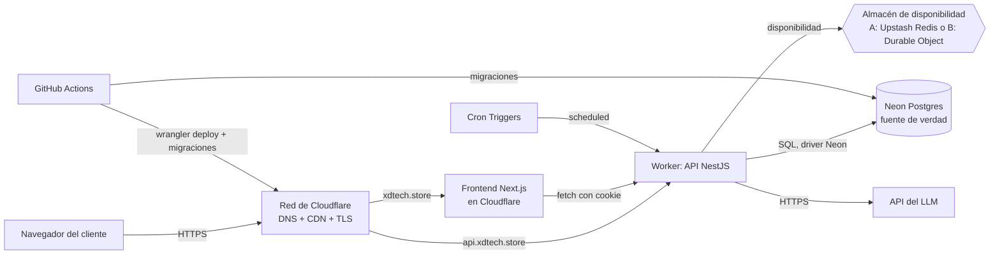
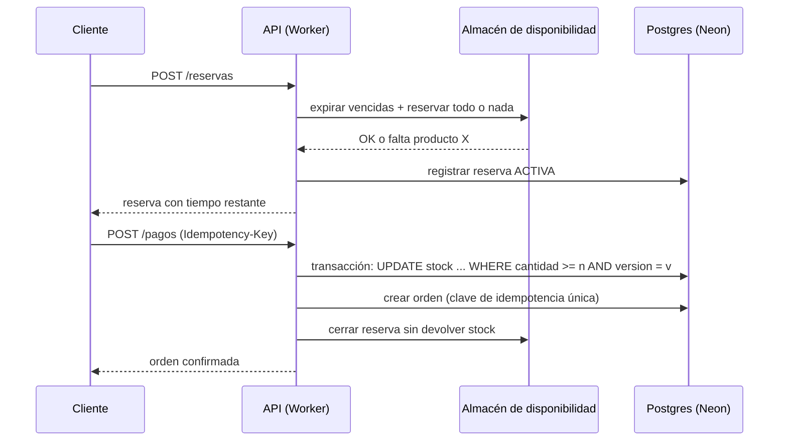
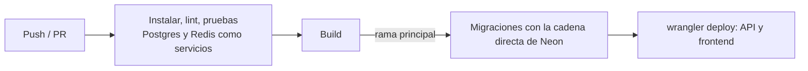

# Arquitectura de despliegue

> Documento de contexto para el agente. Complementa `00_parte_tecnica.md` (que manda ante cualquier diferencia) y no define historias. Todo lo marcado **a validar** se comprueba en el Sprint 0 y se registra en `docs/compatibilidad-cloudflare.md`.

## 1. Arquitectura de alto nivel

### 1.1 Vista general



### 1.2 Piezas

| Pieza | Rol | Plataforma | Estado |
|---|---|---|---|
| Cloudflare (DNS, CDN, TLS) | Entrada única para `xdtech.store` y `api.xdtech.store` | Cloudflare | Fijo |
| Frontend | Next.js: catálogo, armador, carrito, panel | Cloudflare (plan B: Vercel con DNS en Cloudflare) | A validar |
| API | NestJS (adaptador Express) como Worker (plan B: Hono) | Cloudflare Workers | A validar |
| Base de datos | Postgres, fuente de verdad de stock, órdenes, sesiones y uso del asistente | Neon (Prisma con adaptador de Neon) | Fijo |
| Almacén de disponibilidad | Disponible = físico − reservas activas, con reservas atómicas y TTL | Upstash Redis (A) o Durable Object con SQLite (B) | Por decidir en Sprint 0 |
| Tareas programadas | Expiración, reconciliación, limpieza de sesiones | Cron Triggers de Cloudflare | Fijo |
| Proveedor de IA | Recomendaciones, detrás de la interfaz `ProveedorIA` | API externa del LLM | Fijo (proveedor intercambiable) |
| CI/CD | Pruebas, migraciones y despliegue | GitHub Actions + Wrangler | Fijo |

No hay cola de mensajes, balanceador propio, servidor siempre encendido ni monitor externo.

### 1.3 Principios que condicionan el diseño

1. **Postgres es la verdad; el almacén de disponibilidad es la vía rápida.** Si el almacén se pierde, se reconstruye desde Postgres.
2. **Los Workers no guardan estado entre peticiones.** Nada en memoria: ni contadores, ni sesiones, ni cachés de stock.
3. **La IA solo recomienda.** No participa en reservas ni en pagos, y toda recomendación pasa por el motor de reglas.
4. **Cada decisión de plataforma se prueba antes de depender de ella** (Sprint 0).

### 1.4 Dominios y red

| Host | Destino | Mecanismo |
|---|---|---|
| `xdtech.store` (o `app.xdtech.store`) | Frontend | Custom Domain del proyecto en Cloudflare |
| `api.xdtech.store` | Worker de la API | Custom Domain del Worker |

- Ambos comparten el sitio `xdtech.store`, por lo que la cookie de sesión usa `Domain=.xdtech.store` y `SameSite=Lax`.
- CORS con credenciales solo para el origen del frontend.
- La IP del cliente se lee de `CF-Connecting-IP`; `req.ip` no es fiable en Workers.

### 1.5 Flujos principales

**Compra con reserva (camino crítico)**



**Asistente de IA:** el cliente indica presupuesto y uso, la API preselecciona candidatos con stock desde Postgres, llama al LLM (JSON), valida con el motor de reglas, reintenta una vez con los motivos de rechazo y, si falla o hay timeout, usa el armador determinístico. Registra todo en `uso_asistente`.

**Tareas programadas:** tres Cron Triggers invocan el handler `scheduled` del mismo Worker: expiración (cada minuto), reconciliación (cada 5 minutos) y limpieza de sesiones (diaria).

## 2. Arquitectura de bajo nivel

### 2.1 Worker de la API

- `wrangler.jsonc`: nombre, `main: src/worker.ts`, `compatibility_date` ≥ `2026-08-04` (con esa fecha no hace falta el flag `nodejs_compat`), Custom Domain `api.xdtech.store`, bloque `triggers.crons` con los tres horarios, variables no secretas (`COOKIE_DOMAIN`, `FRONTEND_ORIGIN`, `SESSION_TTL_DAYS`).
- `src/worker.ts`: crea una sola vez por instancia la aplicación NestJS, la expone con `createServer` de `node:http` y `httpServerHandler` de `cloudflare:node` (el puerto solo sirve como clave de enrutamiento), y exporta `{ fetch, scheduled }`.
- El handler `scheduled` decide qué trabajo ejecutar según el cron que lo disparó: `expirar`, `reconciliar` o `limpiarSesiones`.
- No hay `listen` real, `upgrade` ni WebSockets, ni `net.Server`.
- **Límites del plan gratuito** (verificados en la documentación): 100 mil peticiones al día, 10 ms de CPU por petición, 50 subrequests, 128 MB, 5 Cron Triggers. Implicación de diseño: pocas consultas por petición, un solo script o método atómico por reserva y un hash de contraseñas medido contra los 10 ms.

### 2.2 Capas dentro de la API

```
Controladores (HTTP, DTOs, guardas de sesión y rol)
        │
Servicios de dominio: catalogo, configuraciones, motor de reglas,
                      carrito, reservas, ordenes, asistente, admin
        │
Puertos: DisponibleService (almacén), ProveedorIA, Prisma (Postgres)
```

- El **motor de reglas** (6 reglas: SOCKET, RAM, POTENCIA, DIMENSIONES, FACTOR_FORMA, ALMACENAMIENTO) es código puro sin dependencias de infraestructura, con parámetros leídos de la base de datos.
- `DisponibleService` es la única puerta al almacén de disponibilidad, con dos implementaciones intercambiables (A y B), para que el resto del código no dependa de la elección.

### 2.3 Base de datos (Neon)

- Dos cadenas de conexión: la de la app (con pooler) para el Worker y la directa para las migraciones en CI.
- Las migraciones de Prisma se aplican en un paso de CI, nunca al arrancar el Worker.
- Neon suspende el cómputo tras 5 minutos sin uso (la primera petición es más lenta); antes de la demo se despierta con una petición real. Plan gratuito: 100 CU-horas al mes.
- Tablas clave para la concurrencia: `stock` (con `version`), `reservas`, `reserva_items`, `ordenes` (con `clave_idempotencia` única), `sesiones`, `uso_asistente`.

### 2.4 Almacén de disponibilidad: dos opciones

| | Opción A: Upstash Redis | Opción B: Durable Object |
|---|---|---|
| Acceso | HTTP/REST con `@upstash/redis` (`eval`/`evalsha`) | Binding al Durable Object `Inventario` |
| Atomicidad | Script Lua que verifica todos los productos y descuenta todos o ninguno | Método `reservar` ejecutado en un solo hilo por el propio objeto |
| Almacenamiento | Claves `disp:{productoId}`, `reserva:{id}` con TTL, `reservas:vencimientos` | Tablas SQLite `disponible`, `reservas`, `reserva_items` |
| Expiración | `expirar.lua` | Método `expirar` |
| Reconstrucción | `SET NX` desde Postgres; clave ausente = "no inicializado", nunca cero | Método `reconstruir` desde Postgres |
| Cuota gratuita | 500 mil comandos al mes | 100 mil peticiones y 100 mil filas escritas al día (SQLite) |
| Contadores de límite de peticiones | `INCR` + `EXPIRE` | En el mismo objeto u otro objeto dedicado |
| Riesgo principal | Consumo de comandos y latencia por REST | Un solo objeto concentra toda la carga; probar con 300 concurrentes |

La elección se toma en el Sprint 0 con la regla de la sección 5.3 de `00_parte_tecnica.md` y se registra antes del Sprint 1.

### 2.5 Sesiones y límites de peticiones

- Sesión: token opaco aleatorio en cookie `httpOnly; Secure; SameSite=Lax; Domain=.xdtech.store`, 7 días. En Postgres se guarda solo el hash del token (tabla `sesiones`). Sin JWT.
- Límites: registro por IP (5/hora), inicio de sesión por correo (5 fallos/15 min, se reinicia al acertar) y por IP (50/15 min), asistente por usuario (10/24 h contado desde `uso_asistente`). Los contadores viven en el almacén elegido, nunca en la memoria del Worker.

### 2.6 Frontend

- Next.js desplegado en Cloudflare con Wrangler (a validar; plan B Vercel).
- Llama a la API con `credentials: 'include'` hacia `api.xdtech.store`; no guarda tokens en el navegador.
- Variable pública con la URL de la API definida en tiempo de compilación.

### 2.7 CI/CD



- Secretos de CI: `CLOUDFLARE_API_TOKEN`, `CLOUDFLARE_ACCOUNT_ID` y la cadena directa de Neon.
- Secretos del Worker con `wrangler secret put`: cadena de Neon, clave de la IA y, si se elige la opción A, credenciales de Upstash. Nada de secretos en el repositorio; `.dev.vars` fuera de git.

### 2.8 Entornos

| Entorno | API | Postgres | Almacén | Uso |
|---|---|---|---|---|
| Local | `wrangler dev` | Docker | Redis local por HTTP (A) o Durable Object local (B) | Desarrollo y k6 |
| CI | Pruebas de integración | Servicio Postgres | Servicio Redis | Verificación |
| Producción | Worker en `api.xdtech.store` | Neon | Upstash o Durable Object | Demo |

Plan de respaldo para la demo: backend con `wrangler dev` y Postgres y Redis en Docker local.

### 2.9 Salud y observabilidad

- `GET /health/live`: sin dependencias, responde 200.
- `GET /health/ready`: verifica Postgres y el almacén de disponibilidad (503 si falla); solo para CI y uso manual.
- Registros de Workers consultables con Wrangler (`wrangler tail`, a validar). Sin monitor externo.

### 2.10 Seguridad en el despliegue

- HTTPS de extremo a extremo gestionado por Cloudflare.
- CORS restringido al origen del frontend; cookie `Secure` y `httpOnly`.
- Guardas de rol en todos los endpoints administrativos; validación de DTOs.
- La clave del LLM solo existe como secreto del Worker.
- Revisión final de que no haya secretos en el repositorio (Sprint 6).

## 3. Riesgos de despliegue y respuesta

| Riesgo | Efecto | Respuesta |
|---|---|---|
| NestJS no arranca bien en Workers (tamaño o CPU) | API inviable | Pasar a Hono antes del Sprint 1 |
| Next.js no funciona en Cloudflare | Frontend bloqueado | Vercel con DNS en Cloudflare |
| Hash de contraseñas excede 10 ms | Errores en login | Ajustar parámetros o plan de pago de Workers |
| Cuota del almacén agotada | Reservas fallan | Cambiar a la otra opción; pruebas de carga siempre en local |
| Neon dormido en la demo | Primera petición lenta | Despertar antes de empezar |
| Cookie entre subdominios rechazada por algún navegador | Sesión no se mantiene | Alternativa decidida en el Sprint 0 |
| Pérdida de datos del almacén | Disponible incorrecto | Reconstrucción perezosa y reconciliación cada 5 minutos |

## 4. Orden de verificación

1. Sprint 0: nueve pruebas de compatibilidad y decisión del caché.
2. Sprint 3: prueba k6 local (300 concurrentes sobre 5 unidades dan exactamente 5 reservas).
3. Sprint 7: despliegue final, verificación de cookie entre subdominios, los tres Cron Triggers y la prueba de humo en producción.
